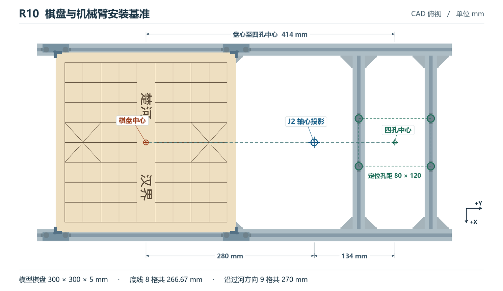

# R10 棋盘固定装配核对

按 R10 的设计位置安装时，棋盘中心、J2 转轴和四个机械臂安装孔的中心在同一条长梁中心线上。现场容易找到的基准是四孔长方形的两条对角线交点。从这个点沿长梁向棋盘量 **414 mm**，就是模型的盘心。实物棋盘用两方九宫的中线与河中央的交点认盘心。



## 夹具与机械臂怎样对位

压缩包的 12 份文件均通过 ZIP 校验。默认配置含一份总装、一份底架子装和 10 种零件。展开得到 54 个零件实例，其中 53 个属于底架与紧固件，另一个是带格线的棋盘。下表取自装配保存的零件变换、实体显示网格及旧版底板孔的圆周顶点。尺寸单位为毫米。[量测数据与两份原包校验值](R10-fixture-measurements-20261123.json) · [读取工具](https://github.com/XRTC5/sldprt-export/tree/31d3b5a9b115d9cbfc19bbf10906fcc29e8e3c57)

| 项目 | CAD 名义量测 | 现场含义 |
| --- | --- | --- |
| 型材底架 | 外廓 690 × 330，两根 690 长梁、五根 290 横梁 | 两条长梁的中线给出棋盘的纵向基准 |
| 机械臂安装 | 四个定位套排成 80 × 120，外径 7.8，内径 5.3 | 旧版 275＋275 机械臂底板有四个直径 8.0 的对应孔 |
| J2 轴心 | 从四孔中心沿长梁向棋盘 134 | J2 位于孔组与棋盘之间，盘心再向前 280 |
| 棋盘角夹 | 四处内挡面间距 300.5 × 300.5，压边下净高 5.4 | 名义 5 厚的板放在横梁上，板面到压边下侧留 0.4 |
| 棋盘高度 | 型材支承面在总装 Z=986，板面在 Z=991，印纹最高再高约 0.032 | 板面相对型材上表面高 5。实机取子高度还取决于实物板、棋子与吸头垫片 |

J2 的位置来自两份模型配准。将旧总装的底板放回其保存姿态，在四个孔各取 24 个圆周顶点拟合，孔心与 R10 四个定位套轴心逐个重合，模型数值差小于 0.001 mm。旧总装给出的 J2 轴在总装平面的位置约为 (0.508, −155.216)，R10 盘心为 (0.508, −435.216)。两者相减得到 (0, −280)。这是 CAD 的配准精度，实物精度需用固定后的独立格点量测。[新版机械臂选型与肩轴来源](SCARA33接收与当前选型.md)

## 模型中的 90 个交点

取 J2 轴心投影为平面原点，+X 横跨短梁，+Y 沿长梁由棋盘指向安装孔组。取两条印线边缘的中点测格距。底线方向 8 格共 266.667 mm，每格 33.333 mm。过河方向 9 格共 270 mm，每格 30 mm，河界之间也是 30 mm。

令列号 c 从 −X 边向 +X 边取 0 至 8，行号 r 从远离 J2 的底线向 J2 取 0 至 9。R10 模型格点的坐标为

```text
X = (c − 4) × 100 / 3     mm
Y = −280 + (r − 4.5) × 30  mm
```

90 个模型交点距 J2 最近 145.0 mm，最远约 435.9 mm，均在两根 275 mm 连杆的径向覆盖范围内。具体关节解仍取决于肩、肘的机械参考与可用姿态。实际红黑朝向确定行列编号与棋谱的对应关系。

## 与现场木棋盘及上次偏差的关系

| 尺寸 | R10 模型 | 此前现场资料 |
| --- | ---: | ---: |
| 棋盘外形，底线方向 × 过河方向 | 300 × 300 | 商品标称 275 × 295 |
| 底线方向最外两格点中心跨度 | 266.667 | 若两侧木边到格点中心都为 15.5，则为 244。上次扫点指令为 242.479 |
| 过河方向最外两格点中心跨度 | 270 | 上次扫点指令为 256.866。固定后取实物印线实测值 |

按原木盘的标称外形，R10 角夹内挡面比木盘两方向分别宽 **25.5 mm 和 5.5 mm**。若实物八格跨度为 244 mm，直接套用模型的 266.667 mm，居中时两侧最外列会各差约 **11.3 mm**。上次观察到的下侧 2–4 mm 偏移来自使用旧布局的那次扫点。此处的 11.3 mm 是这次更换格距时的预测值。

固定后，使用实物盘心在机架上的位置、格线方向、底线八格及过河九格的印线中心跨度，就能生成固定的 90 点。用中部和下侧未参与建系的交点检查吸头中心的实际落点。相机负责识别棋子并归格，现有机械臂关节参考负责把机架方向接入控制程序。以上结果来自离线 CAD 量测，现场装配位置、实物棋面高度和实机落点仍待核对。
