# R13 实物装配与标定

## 先装底架、棋盘和现有机械臂

下表按已有的 275＋275 mm 机械臂、相机和电磁铁继续装。定位套、角夹如果已在本次打印件里，直接清点。螺钉长度指头下长度。

每一行的图片都可以点开放大。零件从 R13 的三维模型分别取景，大小按表中尺寸核对。角码所配的 M4×10 和 M4 槽螺母用示意图标明。

| 安装位置 | 一台用量 | 装配时怎样认 | 零件图 |
| --- | --- | --- | --- |
| 底架 | 2020 型材 690 mm ×2、290 mm ×5，另配 2020 角码 ×14 | 两根长梁在外，五根短梁夹在中间，底架外廓 690 × 330 mm | [](R13零件图/01-底架.png) |
| 角码与型材 | 若手上每个角码两个固定孔，M4×10、适配槽 6 的 M4 T 型螺母各 28 个 | 这是按实物孔数配的用量。先试装一个角码，两面都要能夹紧。螺钉头盖不住孔时配平垫。R13 未画这 28 套紧固件 | [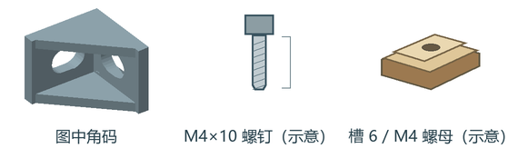](R13零件图/02-角码.png) |
| 棋盘四角 | 左角夹 ×2、右角夹 ×2，四角合计用 M5×10、M5 平垫、槽 6 的 M5 T 型螺母各 8 个 | 每角两颗螺钉，左右夹对角布置 | [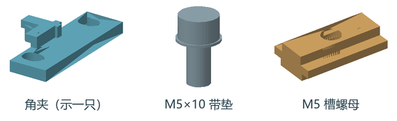](R13零件图/03-棋盘角夹.png) |
| 机械臂底板 | M5×20、M5 平垫、槽 6 的 M5 T 型螺母、定位套各 4 个 | 定位套外径 7.8、内径 5.3、长 13.8 mm。套管进底板四个 Ø8 孔，螺钉穿套锁到横梁 | [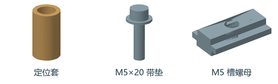](R13零件图/04-底板.png) |

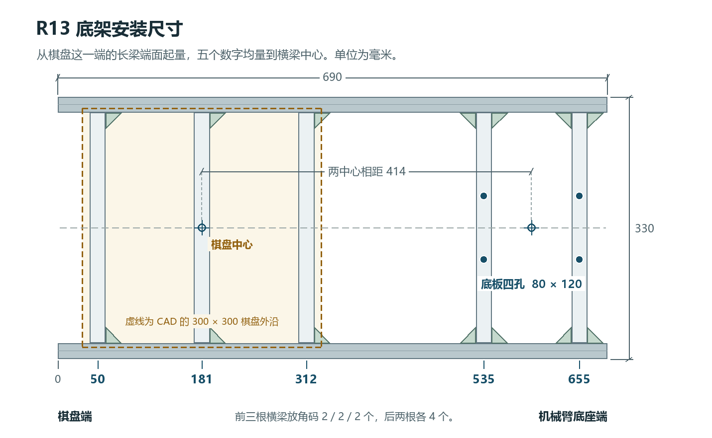

1. 从两根长梁的**棋盘端端面**起量，同一端标出 **50、181、312、535、655 mm**。这些都是横梁中心。需要从端头滑入的槽螺母先入槽。
2. 前三根横梁每根装两个角码，后两根每根装四个。先轻锁，量框架两条对角线，调到相等后再锁紧。
3. 机械臂底板放在最后两根横梁上。四孔中心距沿横梁 **80 mm**、沿长梁 **120 mm**。棋盘放在前三根横梁上，盘心对第二根横梁中心并左右居中。模型中盘心到机械臂底板四孔中心是 **414 mm**。
4. 锁角夹前先试木盘。模型棋盘是 **300 × 300 × 5 mm**，四夹内挡面间距 **300.5 × 300.5 mm**，压边下净高 **5.4 mm**。如果继续用标称 **275 × 295 mm** 的老木盘，先量展开后的实宽、实长以及支承面到夹边上表面的高度。在可调方向滑动角夹，在固定宽度方向用对称挡块或改夹件。夹紧后从四边轻推，棋盘应贴住挡面、四角平稳，中缝摊平。高度不合时把夹口做合适再锁，避免将木盘压弯。

## 如果同时换 R13 相机架、浮动吸头和压轮

| 部位 | 一台用量 | 对应实物 | 零件图 |
| --- | --- | --- | --- |
| 相机悬臂梁 | 2020 型材长 800 mm ×1，左右抱夹各 1，配 M5 螺钉 ×4、槽螺母 ×4 | 左右各两颗。简化螺钉模型的杆长为 16 mm | [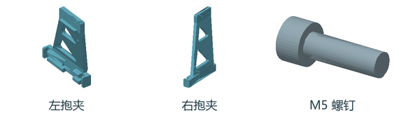](R13零件图/05-相机梁.png) |
| 横梁前端支架与电子仓 | M5×18 与 M5 平垫各 8，M5 防松螺母 4 | 其中四颗螺钉对着 2020 上、下槽。使用普通槽型材时另备 M5 槽螺母 4 个，这四个未单独画出 | [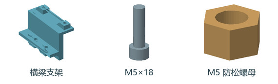](R13零件图/06-电子仓支架.png) |
| 主板、显示板 | M2.5×30、平垫、防松螺母各 8，隔柱 4 根 | 隔柱外径 5、内径 3.2、长 14 mm。图中的 BOARD_TRAY 是电子板托盘 | [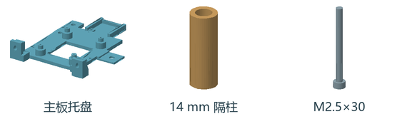](R13零件图/07-板卡.png) |
| 相机小板及电子仓附件 | M1.6×16、小平垫、六角螺母各 6，另配外径 4、厚 0.5 mm 软垫圈 2 | SC3336 小板用其中 4 套 M1.6。其余两套和软垫圈位于扬声器位置。屏幕、扬声器、麦克风和 SMA 天线件按所装电子仓配，棋盘标定只需固定相机、保持全盘入镜 | [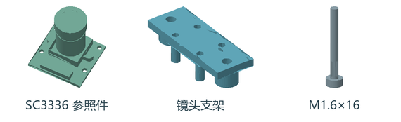](R13零件图/08-相机.png) |
| 浮动吸头 | Ø4 肩部、长 20、末端 M3 的肩螺钉 2，M3 导向螺母 2，压簧 2 | 每根肩轴配一根弹簧。图名给出线径 0.5、外径 7、自由长 20 mm，保存姿态长 17.5 mm | [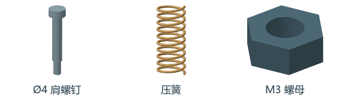](R13零件图/09-浮动吸头.png) |
| 吸头与末端连接 | 上座四颗螺钉和四颗螺母，电磁铁中心一颗螺钉 | 参考模型量得上座杆径 3、头下长 22 mm，螺母配 M3。中心螺钉杆径 4、头下长 12 mm。实物电磁铁用 M4 安装孔，按支架厚度和实物盲孔深度选长度，锁紧后检查吸头能沿两根肩轴顺畅回弹 | [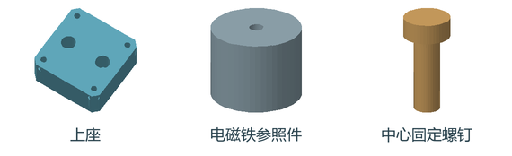](R13零件图/10-吸头固定.png) |
| 大臂同步带压轮 | C-AFBD9-20 压轮 1，配 M5 通轴紧固件 1 套 | 保存模型外径 20、总宽 9、中心配 Ø5 mm 轴。装在**大臂从动轮一侧的调节槽**，垫圈、隔套按实物叠厚配。锁紧后压轮应能自由转动。旧大臂如没有这个槽，先核对臂板版本 | [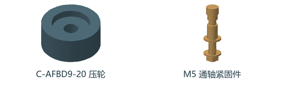](R13零件图/11-压轮.png) |

相机横梁由立柱上端伸向棋盘，镜头朝下。先在原始画面中看到全部外侧交点，调整位置和焦距，再锁紧相机。把相机线、吸头线固定在支架及臂侧，在活动关节留松量。若沿用已装好的电子仓和吸头，可直接检查固定与回弹。

## 安装后的三点、Z 高度与 90 点

1. 确认驱动有已知机械参考。需要读数时运行 `bench\00-check.cmd --four`。若拆装时关节姿态发生变化，在已知实物标记恢复参考后再采点。相机用 `bench\12-camera.cmd --url rtsp://板子地址/live/0 --show` 看现场原图。
2. 站在红方，面对黑方，用吸头圆心依次对准**红方左底角（9,0）、红方右底角（9,8）、黑方底线靠你左手那一角（0,0）**。同一交点各记原始 1280 × 720 图像的像素 u、v 和对中时的 J2、J3 驱动读数。认印刷格线的交叉中心。先留一张吸头移出画面的原图，采像素时格线更容易看清。
3. 装上实际要用的吸头和隔磁垫，用一枚实际棋子示教 J1。先记能可靠吸到的高度，再记能贴近棋面放稳的释放高度，最后从吸取高度**竖直抬约 43 mm** 记搬运高度。用尺量实际抬升量。表中 `z` 一行按“吸取角、搬运角、释放角、实测抬升毫米”填写。之前的 **4.3 mm** 是垫片厚度。装浮动头时按实际接触位置取数，避免依靠弹簧压到底定位。
4. 在同一张表补上已知的机械参考、盘外观察位、弃子点、相机地址和已核对的识别区。在**项目根目录**运行下面前两条，先用三点求出格点，再安装这套实测值。第三条把数值编进 C++ 对局程序。首次尚未构建台架工具时，先执行一次 `bench\01-build.cmd`。

```bat
bench\15-site.cmd "output\bench\R13-实测.txt"
bench\15-site.cmd "output\bench\R13-实测.txt" --install
bench\01-build.cmd
```

5. 先用未参与三点标定的**第四角（0,8）**、盘中央交点和上次偏差明显的边列，比对吸头圆心与印线中心。再用 20 做空吸头 90 点定位。每点到已教棋子顶面上方约 2 mm，记录后回搬运高度再横移。要验实际吸放，再清空棋盘，只在（3,4）放一枚棋，运行 21。它最后送回起点、回观察位。

```bat
bench\20-grid90.cmd --site "config\site\installation.site" --plan
bench\20-grid90.cmd --site "config\site\installation.site"
bench\21-pick90.cmd --site "config\site\installation.site" --start 3 4
```

20 记录的角度和到位状态可在 `output/bench/runs` 查看。吸头中心与印线之间的毫米偏差仍需现场观察或量测，尤其是上次出现 2–4 mm 偏移的边列。需要新的空白示教表时，用 `bench\15-site.cmd --template 新文件名.txt` 生成。

尺寸和件数取自 `R13_FULL_ASSEMBLY.SLDASM` 保存的配置，展开共 351 个零件实例，包含棋子和已有机构。角码紧固件和相机梁前端额外的四个槽螺母按装配需要另列。原包 SHA-256 为 `4133a9aa5b48a1ba9def0bd5a09ab5492941aa452d877461d9bcdf059ccc17b3`。在 SolidWorks 2026 中查看时，将 ZIP 完整解压到同一目录，从顶层总装打开。
