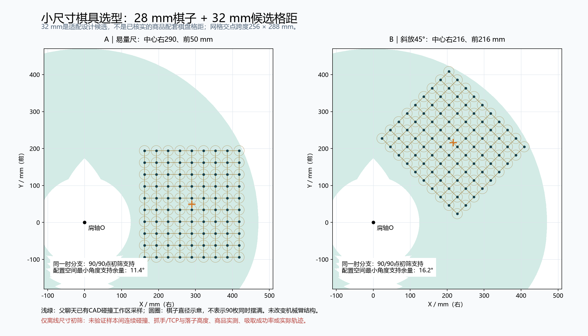

# 小尺寸中国象棋选购与现有机械臂适配

查询日期：2026-10-09（Asia/Shanghai）。本报告属于07子聊天；父聊天05负责汇总。只读取既有CAD碰撞数据，未访问SolidWorks、修改模型或运行配置，也未购买商品。

## 结论

**优先选得力小号实木中国象棋的28mm版本（6732系列是检索入口），配套棋盘必须核实格距；机械适配优先考察30～32mm格距，而不是只换小棋子。**

在目前能公开核查的常见商品中，28mm实木版本的规格交叉证据比某些“25mm/18710”条目更一致。另有更小的得力桦木25mm店铺SKU可作备选，但同一18710型号在不同页面出现25、28和30mm写法，不能只按型号下单。

如果仍使用原40mm交点间距，只把35mm棋子换小，90个目标坐标并没有变化，父聊天已发现的6个碰撞点仍不能据此解决。小棋子的价值是允许缩小格距并调整摆位。

本次找到了**28mm棋子＋32mm候选格距（交点跨度256×288mm）**以及**25mm棋子＋30mm候选格距（240×270mm）**的现有结构适配方案，均在同一肘分支上取得90/90点的离线采样支持。但商品配套棋盘的实际格距没有可靠公开证据，因此**不能宣称某个现售整套商品已经验证整盘可抓**。

## 买什么、怎么找到

| 优先级 | 商品入口与精确搜索词 | 已查到的规格 | 价格口径 | 仍需核实 |
|---|---|---|---|---|
| 首选 | 得力6732系列，小号28mm实木折叠中国象棋；搜索 `得力 6732 小号 28mm 实木 中国象棋 非磁性` | 京东目录有28mm实木选项；亚米6732页面明确写28mm、实木棋子与防水折叠棋盘 | [返利页面](https://m.fanli.com/item/d40717026698)展示淘宝参考¥29.90，**不是本次登录结算确认的实时价格** | 具体发货版本、非磁性确认、棋子厚度/单枚重量、顶面密封性、横纵格距、河界间隔和最外侧交点跨度 |
| 更小备选 | 得力桦木25mm店铺SKU；搜索 `得力 桦木 中国象棋 25mm 2.5cm 非磁性` | 京东目录存在25mm桦木SKU，部分写18710 | 具体25mm SKU实时价未取得，不用混合规格最低价代替 | 尤其要核实直径；18710存在25/28/30mm信息冲突，其余项目同上 |

大陆购买候选入口：[京东28mm实木SKU](https://item.jd.com/10211391885658.html)、[京东25mm桦木SKU](https://item.jd.com/10041423354510.html)。商品详情抓取未能取得完整动态页面；入口来自京东目录，不等于已验证当前收货地库存或到货日期。如果链接切到其他规格，按上述尺寸关键词筛选，不能用“大号/中号/小号”的文字替代毫米值。

规格交叉来源：[京东得力象棋目录](https://www.jd.com/jiage/1318af4706e2bf8737f0.html)、[亚米6732商品页](https://www.yami.com/zh/p/6732/1166003661)。亚米仅用于规格交叉核查，**不建议为了本项目从海外购买**，也不把美元报价换算成大陆报价。

目前没有取得得力厂家完整尺寸图。[中国建材商城目录](https://mall.cnbm.com.cn/mall-view/product/search?businessType=1&cid=3304)虽标注得力集团供货并给出6732的277×156×27mm目录尺寸，但没有明确证明它是展开外板还是包装/折叠尺寸，更没有给交点尺寸，本报告没有据此推算格距。[18710商品百科](https://wiki.smzdm.com/p/zmn1eo1/)自身也存在3cm标题与28mm规格文字，作为冲突证据保留，不选它覆盖25mm目录声明。

## 为什么不优先买超迷你磁吸旅行棋

15.5mm、20mm、25mm磁吸折叠款在得力电商目录中可见，但对本项目有两个取舍：磁吸会增加离盘时需克服的吸附力，薄小棋子的可密封顶面和字形像素也更少。并非一律不能用，而是需要先测实际磁力、吸盘能力和视觉识别，不能只因外形小就优先推荐。

实木也不自动等于好吸。顶面深刻字、环槽、粗糙或多孔表面可能使吸盘漏气；应确认吸盘密封唇能落在连续、平整的区域。工业厂商也针对粗糙木材设置专用密封结构，说明需要结合表面选吸盘，而不是按“木质”二字保证成功。[Schmalz木材吸盘说明](https://www.schmalz.com/en/vacuum-technology-for-automation/vacuum-components/vacuum-suction-cups/suction-cups-for-handling-wood/flat-suction-cups-shfn-304333/)是表面密封原理参考，不是推荐该大尺寸工业型号装到棋子上。

视觉上继续识别红黑14种身份。若仍采用此前仅用于预算的800mm水平视场、1280像素宽，35/28/25/20/15.5mm棋子直径约对应56/44.8/40/32/24.8像素。这是比例计算，不是镜头实测或YOLO精度保证。选小棋后应重新取图、按该固定棋具训练/验证，不能默认沿用35mm棋具的效果。优先清楚的红黑字和低反光表面。

## 两套可量尺复核的尺寸方案

下表中的格距是**设计候选值**，不是以上商品原装棋盘参数。肩轴为(0,0)，+X向右，+Y沿父聊天原装配伸臂前方。棋盘9列沿X、10行沿Y；因此长边沿Y。

| 方案 | 棋子/格距 | 最外侧交点跨度 | 网格中心 | 交点坐标范围 | 单一肘分支初筛 |
|---|---|---|---|---|---|
| 小尺寸优先 | 25mm棋子 / 30mm格距 | 240×270mm | (290,50)mm | X=170～410，Y=-85～185mm | 90/90支持，q2取负分支 |
| 28mm常见款适配 | 28mm棋子 / 32mm格距 | 256×288mm | (290,50)mm | X=162～418，Y=-94～194mm | 90/90支持，q2取负分支 |
| 28mm斜放候选 | 28mm棋子 / 32mm格距 | 256×288mm，旋转45° | (216,216)mm | 旋转后的坐标见JSON | 90/90支持，q2取负分支 |

第一套相邻棋子理论净间隔5mm，第二套4mm；这不是给工具留下的已验证碰撞间隙。28mm棋子若放30mm格距，静态间隔只剩2mm，因此这里为28mm棋子优先给出32mm方案。棋盘边框、ArUco白边、收纳区与相机视场应在落子网格之外另行规划。

32mm轴线平行方案的关节范围为J1约-73.55～35.41°、J2约-144.58～-23.02°；角度符号沿用父聊天。其最远交点半径约460.8mm，**这里的推荐依据是碰撞采样支持域，不是圆环半径检验**。这些数值不是实机角度限位。

建议先用轴线平行方案做纸样摆位，便于量尺核对；桌面允许斜放时，再比较45°方案。这里“右侧”由项目坐标定义，不是根据人坐在哪一侧猜测。镜像左侧是否同样通过需要按实际组件不对称性重新算，未自动承诺。

## 计算证据与边界

只读父聊天的 `output/constrained-workspace-2026-10-09/cad-collision-scan.npz`，记录了源文件SHA-256。没有导入其COM脚本，也没有新增SolidWorks调用。

每个交点用195/275mm两段轴距求解析IK。一个候选必须使90点在**同一肘分支**上落入四角均通过CAD检查的4°采样单元；另为选型避开q2=0附近±10°，这只是本次离线选择条件。配置空间到支持域边界的距离用角度表示，不能转换叫作实体毫米净空。以中心(290,50)方案为例，30mm格距最小角度支持余量约13.43°，32mm格距约11.42°；32mm的45°方案约16.22°。所有值都是模型初筛指标。

上述三套方案的FK回代误差均小于3e-13mm，这是数值计算一致性。分别施加平移X/Y各-3、0、3mm以及旋转-0.5、0、0.5°的27种离线扰动，每种仍为90/90点落入同一分支的采样支持域。**±3mm不是机械臂实测精度，27种通过也不是连续碰撞或抓取成功验收。**

有限搜索比较了25/28/30/32/35/40mm格距，中心粗搜10mm后局部2mm细搜，方向只比较0/30/45/60/90°。40mm格距没有在这个有限搜索里找到90点同一分支方案；这不能证明所有可能摆位都不存在，也不是推翻父聊天逐点实体检测的另一份精确CAD结论。35mm格距虽能找到几何方案，但35mm棋子本身在该格距没有静态间隙，所以不能据此推荐原35mm棋子直接缩格。

未验证项包括：商品实际网格与河界比例、棋子高度重量、吸盘密封及提起力、TCP和落子高度、板厚、所有高度下的避碰、独立末端R姿态、吃子收纳与完整运动路径。只有端点落入支持域，不能称整局实机抓取通过。

## 下单规格核对文本

可直接向所选店铺询问：“请确认所选小号这一版棋子的实测直径和厚度，是否无磁；请量最左到最右9列交点的跨度，以及最前到最后10行交点的跨度，并确认河界那一格是否与其他格同宽。请提供棋子顶面近照，看是否有深雕字或凹槽。我要的是交点中心距离，不是外盒或棋盘外边框尺寸。”

若原装棋盘格距不合适，可以保留合格的小棋子，另配30/32mm格距的平整非磁性棋盘，再按实际网格重算。不要为省一步而假定原装盘等于本报告的设计候选。

## 文件

- [市场证据与未知项](market-evidence.json)
- [布局逐点结果](layout-evaluation.json)
- [FK与摆放扰动复核](verification.json)
- [摆位图PNG](candidate-layouts.png)、[SVG](candidate-layouts.svg)
- 重算：使用安装MCP时创建的Python环境运行 `evaluate_layouts.py`，再运行 `render_and_verify.py`；脚本只读原始碰撞矩阵，仅写本目录。

本报告未改写公共参数文档；由05父聊天阅读后统一汇总。
